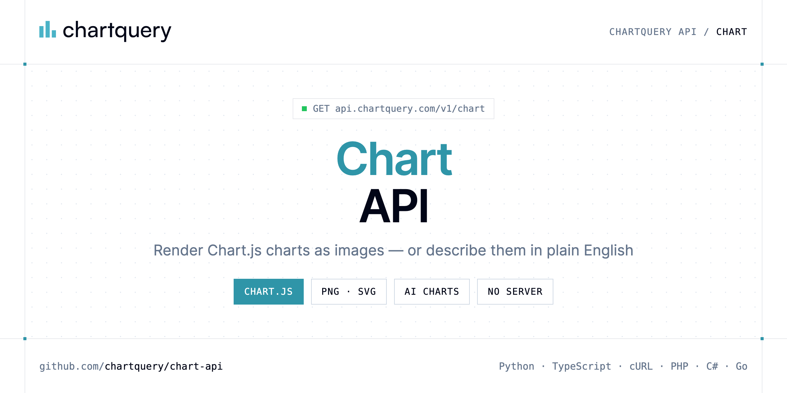

<p align="center">
  <a href="https://www.chartquery.com"></a>
</p>

# Chart API

[](https://discord.gg/CFj3ph8aHU) [](https://app.chartquery.com/register) [](https://app.chartquery.com/openapi) [](LICENSE)

The **ChartQuery Chart API** renders a Chart.js configuration as an image, or generates a chart from a plain-English prompt with AI.

- **Chart Render API** — Render a Chart.js image via GET.
- **AI Chart API** — Describe a chart in plain English via GET and get a rendered image back.

Use it for charts in emails, PDF reports, Slack bots, dashboards and AI assistants.

| Endpoint | Request | Credits |
|---|---|---|
| [Chart Render API](#chart-render-api) | `GET /v1/chart` | 5 |
| [AI Chart API](#ai-chart-api) | `GET /v1/chart/ai` | 10 |

## Table of contents

- [How it works](#how-it-works)
- [Chart Render API](#chart-render-api)
- [AI Chart API](#ai-chart-api)
- [Code examples in other languages](#code-examples-in-other-languages)
- [Use cases](#use-cases)
- [Why ChartQuery?](#why-chartquery)
- [FAQ](#faq)
- [Official SDKs](#official-sdks)
- [Related repositories](#related-repositories)
- [Support](#support)

## How it works

1. **Create a ChartQuery account** and copy your API key from the [dashboard](https://app.chartquery.com/register).
2. **Call `https://api.chartquery.com`** with the header `x-api-key: YOUR_API_KEY`.
3. **Use the result** in your app — no infrastructure to run.

```bash
export CHARTQUERY_API_KEY="your-api-key"
pip install requests        # Python
# TypeScript: Node.js 18+ (native fetch), run with `npx tsx file.ts`
```

## Chart Render API

Render a Chart.js image via GET. Pass the full chart object as URL-encoded JSON in query. Prefer format png for ChatGPT. POST sends the same object as a JSON body, not query.

`GET https://api.chartquery.com/v1/chart` · **5 credits per request** · [API reference](https://app.chartquery.com/openapi)

### Request parameters

| Parameter | In | Type | Required | Description |
|---|---|---|---|---|
| `query` | query | string | ✅ | Full chart config as URL-encoded JSON. Pass `?version=` or `?v=` separately to pin the chart version. |
| `version` | query | string | — | Chart.js version to use. Alias: ?v=. Only v4.x is supported. Defaults to the installed version (4.5.1). Example: "4", "4.5", "4.5.1". The installed version is always returned in the X-ChartJS-Version response header. |
| `share` | query | boolean | — | If true, persist the result and return share URLs instead of an image. Leave false to get the image. |

### Python example

```python
import os

import requests

API_KEY = os.environ["CHARTQUERY_API_KEY"]
HEADERS = {"x-api-key": API_KEY}

response = requests.get(
    "https://api.chartquery.com/v1/chart",
    headers=HEADERS,
    params={
        "query": "{\"type\":\"bar\",\"title\":\"Monthly Sales\",\"legend\":\"bottom\",\"width\":1200,\"height\":600,\"device_pixel_ratio\":1,\"data\":{\"labels\":[\"Jan\",\"Feb\",\"Mar\",\"Apr\",\"May\",\"Jun\"],\"datasets\":[{\"label\":\"2025\",\"data\":[42,58,37,65,49,72],\"backgroundColor\":\"rgba(99,102,241,0.85)\"},{\"label\":\"2026\",\"data\":[51,67,44,71,58,85],\"backgroundColor\":\"rgba(249,115,22,0.85)\"}]},\"scales\":{\"y\":{\"beginAtZero\":true}}}",
    },
    timeout=120,
)
response.raise_for_status()

with open("chart.png", "wb") as f:
    f.write(response.content)
print("Saved chart.png", len(response.content), "bytes")
```

### TypeScript example

```typescript
import { writeFile } from "node:fs/promises";

const headers = { "x-api-key": process.env.CHARTQUERY_API_KEY!, "Content-Type": "application/json" };

const params = new URLSearchParams({
  "query": "{\"type\":\"bar\",\"title\":\"Monthly Sales\",\"legend\":\"bottom\",\"width\":1200,\"height\":600,\"device_pixel_ratio\":1,\"data\":{\"labels\":[\"Jan\",\"Feb\",\"Mar\",\"Apr\",\"May\",\"Jun\"],\"datasets\":[{\"label\":\"2025\",\"data\":[42,58,37,65,49,72],\"backgroundColor\":\"rgba(99,102,241,0.85)\"},{\"label\":\"2026\",\"data\":[51,67,44,71,58,85],\"backgroundColor\":\"rgba(249,115,22,0.85)\"}]},\"scales\":{\"y\":{\"beginAtZero\":true}}}",
});

const response = await fetch(`https://api.chartquery.com/v1/chart?${params}`, { headers });
if (!response.ok) throw new Error(`HTTP ${response.status}: ${await response.text()}`);

await writeFile("chart.png", Buffer.from(await response.arrayBuffer()));
console.log("Saved chart.png");
```

### Output

The response body is the generated file (saved as `chart.png` in every example). Error responses are JSON with an explanatory message.

## AI Chart API

Describe a chart in plain English via GET and get a rendered image back. Powered by AI.

`GET https://api.chartquery.com/v1/chart/ai` · **10 credits per request** · [API reference](https://app.chartquery.com/openapi)

### Request parameters

| Parameter | In | Type | Required | Description |
|---|---|---|---|---|
| `prompt` | query | string | ✅ | Describe your chart in plain English (max 1000 chars). Be specific: mention chart type, data topic, colors, style. |
| `raw_data` | query | string | — | Raw data for the chart. URL-encoded string, CSV, or JSON. AI will parse and structure it. |
| `title` | query | string | — | Override the chart title generated by AI. |
| `subtitle` | query | string | — | Override the chart subtitle. |
| `legend` | query | string (`top`, `bottom`, `left`, `right`, `chartArea`, `false`) | — | Legend position or visibility. Use "false" to hide. |
| `format` | query | string (`png`, `svg`) | — | Output format. Default: "png". |
| `width` | query | number | — | Image width in pixels (50–4000). Default: 1200. |
| `height` | query | number | — | Image height in pixels (50–4000). Default: 600. |
| `background` | query | string | — | Background color as a hex value. Default: #ffffff. |
| `device_pixel_ratio` | query | number | — | Device pixel ratio for the rendered image. Default: 1. |
| `share` | query | boolean (`false`, `true`) | — | Set share=true to persist the config and receive JSON instead of an image: { id, render_url, view_url, embed_url, expires_in }. Free plan: 3-day expiry with watermark. Paid plan: 6-month expiry, no branding. |

### Python example

```python
import os

import requests

API_KEY = os.environ["CHARTQUERY_API_KEY"]
HEADERS = {"x-api-key": API_KEY}

response = requests.get(
    "https://api.chartquery.com/v1/chart/ai",
    headers=HEADERS,
    params={
        "prompt": "Bar chart of monthly sales from January to June, indigo bars, clean style",
        "format": "png",
    },
    timeout=120,
)
response.raise_for_status()

with open("ai-chart.png", "wb") as f:
    f.write(response.content)
print("Saved ai-chart.png", len(response.content), "bytes")
```

### TypeScript example

```typescript
import { writeFile } from "node:fs/promises";

const headers = { "x-api-key": process.env.CHARTQUERY_API_KEY!, "Content-Type": "application/json" };

const params = new URLSearchParams({
  "prompt": "Bar chart of monthly sales from January to June, indigo bars, clean style",
  "format": "png",
});

const response = await fetch(`https://api.chartquery.com/v1/chart/ai?${params}`, { headers });
if (!response.ok) throw new Error(`HTTP ${response.status}: ${await response.text()}`);

await writeFile("ai-chart.png", Buffer.from(await response.arrayBuffer()));
console.log("Saved ai-chart.png");
```

### Output

The response body is the generated file (saved as `ai-chart.png` in every example). Error responses are JSON with an explanatory message.

## Code examples in other languages

Ready-to-run examples live in [`examples/`](examples); each reads your key from `CHARTQUERY_API_KEY`.

| Language | `chart` | `chart-ai` |
|---|---|---|
| cURL (Bash) | [chart.sh](examples/curl/chart.sh) | [chart_ai.sh](examples/curl/chart_ai.sh) |
| PHP | [chart.php](examples/php/chart.php) | [chart_ai.php](examples/php/chart_ai.php) |
| C# | [Chart.cs](examples/csharp/Chart.cs) | [ChartAi.cs](examples/csharp/ChartAi.cs) |
| Go | [chart.go](examples/go/chart.go) | [chart_ai.go](examples/go/chart_ai.go) |
| Java | [ChartExample.java](examples/java/ChartExample.java) | [ChartAiExample.java](examples/java/ChartAiExample.java) |
| Ruby | [chart.rb](examples/ruby/chart.rb) | [chart_ai.rb](examples/ruby/chart_ai.rb) |
| Node.js | [chart.mjs](examples/nodejs/chart.mjs) | [chart_ai.mjs](examples/nodejs/chart_ai.mjs) |

## Use cases

- **Email & PDF reports** — Embed charts where JavaScript can't run.
- **Chatbots & AI agents** — Return charts as images from Slack, Discord or ChatGPT tools.
- **Automated reporting** — Generate weekly KPI charts from your data pipeline.

## Why ChartQuery?

- **Images in one request** — the response body is the PNG/SVG/PDF, ready for emails, PDFs, dashboards, Slack or `` tags.
- **Charts, diagrams, QR codes, barcodes, labels** — Chart.js configs, 28 diagram languages (Mermaid, Graphviz, PlantUML, D2…), 25+ barcode formats.
- **AI generation** — describe a chart or diagram in plain English and get the rendered image.
- **No rendering infrastructure** — no headless browser, fonts or libraries to maintain.
- **Copy-paste examples** — Python and TypeScript in each README, 7 more languages in `examples/`.

## FAQ

### How do I authenticate?

Create an account on [ChartQuery](https://app.chartquery.com/register), copy your API key and send it in the `x-api-key` header of every request to `https://api.chartquery.com`.

### How much does a request cost?

Credits per call: `/v1/chart` **5**, `/v1/chart/ai` **10**. See [ChartQuery pricing](https://www.chartquery.com/pricing).

### What does the API return?

The response body is the file itself (image or document). Save it directly to disk or stream it to your storage — every example in this repository writes the file locally.

### Which languages are supported?

Any language that can make an HTTP request. This README shows Python and TypeScript; the [`examples/`](examples) folder contains cURL, PHP, C#, Go, Java, Ruby and Node.js.

## Official SDKs

Use ChartQuery from your own language with a typed client:

| SDK | Package | Install |
| --- | --- | --- |
| Node.js | [`@chartquery/sdk`](https://www.npmjs.com/package/@chartquery/sdk) | `npm install @chartquery/sdk` |
| Python | [`chartquery`](https://pypi.org/project/chartquery/) | `pip install chartquery` |
| Go | [`chartquery-go`](https://pkg.go.dev/github.com/chartquery/chartquery-go) | `go get github.com/chartquery/chartquery-go` |
| .NET | [`ChartQuery`](https://www.nuget.org/packages/ChartQuery) | `dotnet add package ChartQuery` |
| Ruby | [`chartquery`](https://rubygems.org/gems/chartquery) | `gem install chartquery` |
| PHP | [`chartquery/sdk`](https://packagist.org/packages/chartquery/sdk) | `composer require chartquery/sdk` |
| Java | [`chartquery-java`](https://github.com/chartquery/chartquery-java) | build from source, see its README |
| CLI | [`@chartquery/cli`](https://www.npmjs.com/package/@chartquery/cli) | `npm install -g @chartquery/cli` |
| MCP server | [`@chartquery/mcp`](https://www.npmjs.com/package/@chartquery/mcp) | `npx -y @chartquery/mcp` |

## Related repositories

- [Diagram API](https://github.com/chartquery/diagram-api)
- [QR Code API](https://github.com/chartquery/qr-code-api)
- [Barcode API](https://github.com/chartquery/barcode-api)
- [Thermal Label API](https://github.com/chartquery/thermal-label-api)
- [All ChartQuery repositories](https://github.com/chartquery)

## Support

- 💬 Join the [Discord](https://discord.gg/CFj3ph8aHU) to ask questions and share what you build.
- 📚 Read the [API reference](https://app.chartquery.com/openapi).
- 🔑 [Get your API key](https://app.chartquery.com/register).

---

<p align="center">
  <a href="https://www.chartquery.com">
    <picture>
      <source media="(prefers-color-scheme: dark)" srcset="images/logo-dark.svg">
      
    </picture>
  </a>
  <br>
  <sub>Built by <a href="https://www.chartquery.com">ChartQuery</a>. Examples are released under the MIT license.</sub>
</p>
